 

**Software Developer** &nbsp;·&nbsp; **Digital Solutions** &nbsp;·&nbsp; **BSc Computer Science**

 

I'm **Meshal Alshammari**, a software developer with a Bachelor's degree in Computer Science.

I like turning ideas into working software — web applications, digital products and interactive experiences that people can actually pick up and use. I care about the whole picture: a clear interface, sensible data, and details that hold up on a phone as well as on a desktop. Much of what I build is bilingual, designed for both Arabic and English speakers.

<code>Software&nbsp;Development</code>&nbsp;
<code>Web&nbsp;Applications</code>&nbsp;
<code>Digital&nbsp;Solutions</code>&nbsp;
<code>Interactive&nbsp;Experiences</code>&nbsp;
<code>Educational&nbsp;Technology</code>&nbsp;
<code>Modern&nbsp;Dev&nbsp;Tools</code>

 

**War of Letters · حرب الحروف** — A real-time, two-team Arabic trivia game played on a hexagonal letter grid. Teams claim letters by answering questions and race to connect their walls, with optional action cards, a host screen, and players joining from their phones by QR code.

<code>React</code> <code>TypeScript</code> <code>Vite</code> <code>Tailwind&nbsp;CSS</code> <code>Framer&nbsp;Motion</code> <code>Zustand</code> <code>Supabase</code> <code>PostgreSQL</code>

**[→ Repository](https://github.com/xg3u/war-of-letters)** &nbsp;·&nbsp; **[→ Live site](https://battleofletter.com/)**

 

**Customer Spending Predictor** — A bilingual (English / Arabic, RTL) Streamlit app that estimates a customer's spending score from age, income, membership and purchase frequency, then turns it into a segment and concrete business recommendations, with gauge and feature-weight charts.

<code>Python</code> <code>Streamlit</code> <code>pandas</code> <code>NumPy</code> <code>Plotly</code>

**[→ Repository](https://github.com/xg3u/Customer-Spending-Predictor)**

 

More projects are in active, private development — they'll appear here as they go public.

 

<b>LANGUAGES</b>  

<b>FRONTEND</b>  

<b>BACKEND &amp; DATA</b>  

<b>TOOLS</b>  

 

Languages are measured from public repositories. The live contribution graph is shown by GitHub just below this profile.

 

